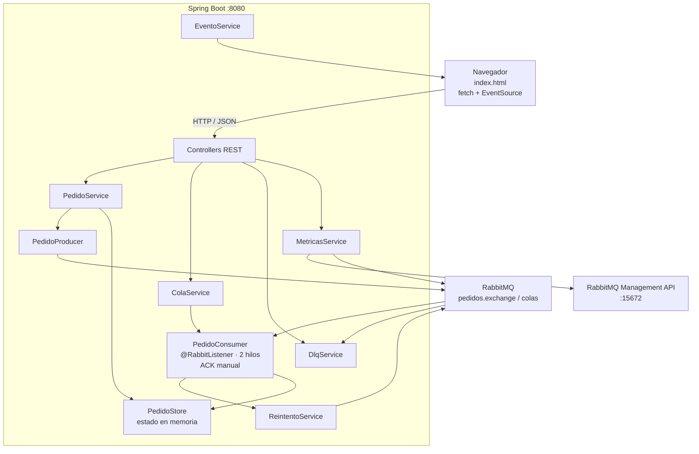
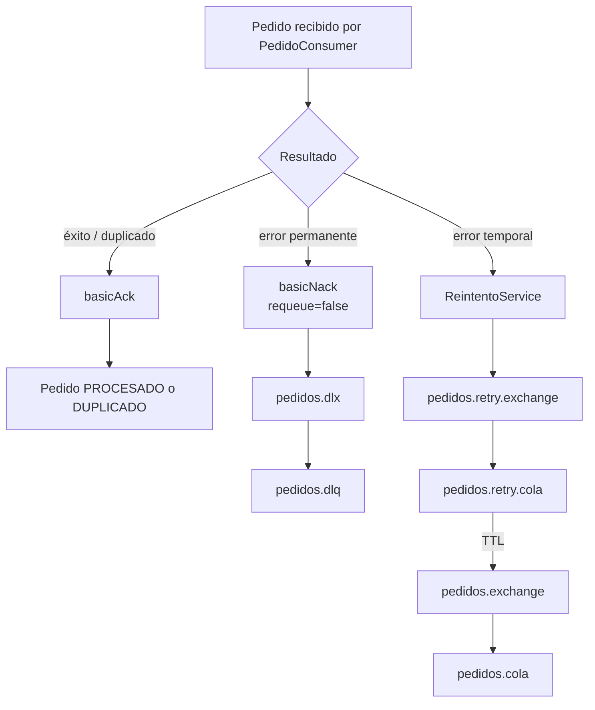
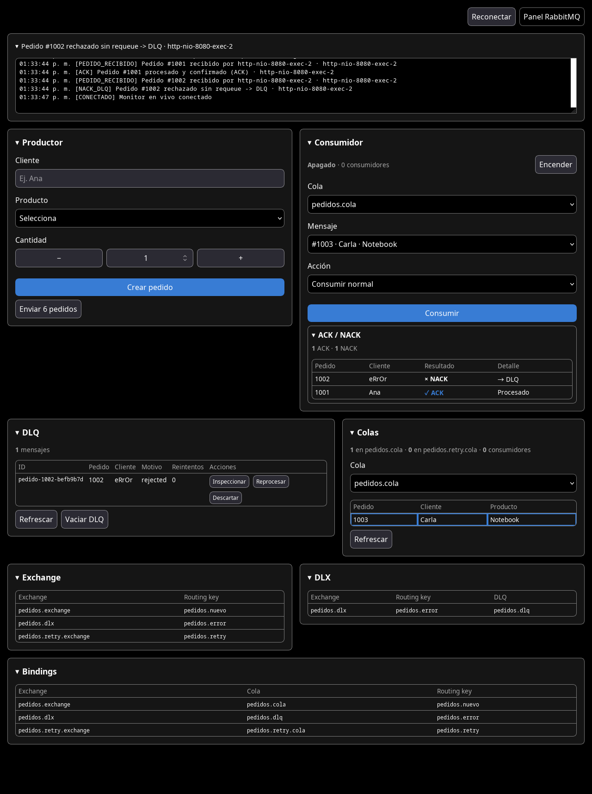

# MiniPedidos

## 1. Descripción general

MiniPedidos implementa el ciclo completo de un pedido usando RabbitMQ como broker:

- Publicación asíncrona de pedidos desde una API REST y desde un panel web.
- Enrutamiento mediante exchange, binding y cola.
- Dos consumidores concurrentes sobre la misma cola (*competing consumers*).
- Confirmación manual de mensajes con `basicAck` / `basicNack`.
- Errores permanentes y temporales con caminos distintos.
- Reintentos mediante una cola con TTL y dead-lettering.
- DLX/DLQ para mensajes rechazados o agotados.
- Idempotencia por `messageId`.
- Consumo manual de un mensaje puntual.
- Inspección, reproceso, descarte y purga de la DLQ.
- Administración de colas, exchanges y bindings por API.
- Métricas de colas y pedidos.
- Eventos en vivo mediante Server-Sent Events (SSE).

El estado de pedidos, eventos, política de reintentos e idempotencia se mantiene en memoria. RabbitMQ conserva las colas y los mensajes durables. Al reiniciar el proceso se renueva el estado en memoria; los mensajes que sigan en RabbitMQ permanecen.

### Stack

| Componente | Tecnología |
|---|---|
| Lenguaje | Java 17 |
| Framework | Spring Boot 4.1.1 |
| Mensajería | Spring AMQP + RabbitMQ 4.2 |
| Web | Spring MVC + Validación Jakarta |
| Serialización | Jackson JSON |
| Frontend | HTML, CSS y JavaScript vanilla; recursos estáticos |
| Build | Maven Wrapper (`mvnw`) |
| Pruebas | JUnit 5 + Spring Boot Test |

## 2. Arquitectura

### 2.1 Vista de componentes



### 2.2 Flujo de un pedido

1. `POST /api/pedidos` crea un `Pedido`, le asigna `pedidoId` y `messageId`, lo guarda en `PedidoStore` y lo publica como mensaje persistente en `pedidos.exchange` con routing key `pedidos.nuevo`.
2. El exchange enruta el mensaje a `pedidos.cola`.
3. Uno de los dos consumidores de `PedidoConsumer` recibe el mensaje.
4. `PedidoConsumer` valida, aplica la simulación de errores y ejecuta el efecto de negocio simulado.
5. El resultado se resuelve con ACK o NACK:



- **Éxito:** se marca el pedido como `PROCESADO` y se confirma el mensaje.
- **Duplicado:** si el `messageId` ya fue procesado, se hace ACK sin repetir el efecto de negocio.
- **Error permanente:** se marca `FALLIDO`, se anota el error en cabeceras y se hace NACK sin requeue. RabbitMQ lo envía al DLX y de ahí a la DLQ.
- **Error temporal:** si quedan reintentos, se publica una copia persistente en la cola de reintentos con TTL y se hace ACK del original. Cuando expira el TTL, RabbitMQ devuelve la copia al exchange principal. Si se agotan los reintentos, NACK sin requeue y DLQ.
- **Error de publicación:** si el productor no puede publicar, el pedido queda en estado `ERROR_ENVIO` y la API responde con error.

### 2.3 Concurrencia

El consumidor principal se declara con:

```java
@RabbitListener(
    id = "pedidoConsumer",
    queues = "pedidos.cola",
    concurrency = "${demo.consumidores:2}"
)
```

- `demo.consumidores` define el número de hilos; por defecto son 2.
- `prefetch=1`: cada consumidor recibe como máximo un mensaje no confirmado a la vez.
- `acknowledge-mode=manual`: Spring no confirma automáticamente.
- `spring.rabbitmq.listener.simple.retry.enabled=false`: los reintentos los decide la aplicación, no el listener de Spring.
- `default-requeue-rejected=false`: un rechazo no vuelve automáticamente a la cola.
- El `id` del contenedor permite encenderlo y apagarlo con `RabbitListenerEndpointRegistry`.

La pausa de `demo.procesamiento.delay-ms` simula trabajo real y hace visible el reparto entre consumidores.

### 2.4 Idempotencia

`PedidoConsumer` mantiene un `Set<String>` concurrente con los `messageId` procesados:

- El `messageId` se genera en el productor con el formato `pedido-{pedidoId}-{uuid corto}`.
- Si un mensaje se entrega de nuevo, se hace ACK sin volver a ejecutar el efecto de negocio.
- El reproceso desde la DLQ conserva el `messageId`.
- El conjunto se mantiene en memoria y se reinicia con la aplicación.

### 2.5 Consumo manual

El panel y la API permiten consumir un mensaje puntual sin esperar al listener:

1. `ColaService` usa `basicGet(autoAck=false)` para inspeccionar hasta `demo.cola.max-inspeccion` mensajes.
2. Identifica el mensaje por `messageId`, cabecera `x-pedido-id` o `pedidoId` del cuerpo.
3. Reconstruye un `Message` y llama a `PedidoConsumer.procesar(...)`, reutilizando exactamente las reglas de ACK/NACK, reintentos, idempotencia y DLQ.
4. Los mensajes restantes se devuelven con `basicNack(requeue=true)`.

La UI deshabilita el formulario mientras el consumidor automático está encendido.

### 2.6 Observabilidad y panel web

- `EventoService` publica eventos en memoria y los difunde por SSE.
- `GET /api/eventos` devuelve el historial (máximo 250, más reciente primero).
- `GET /api/eventos/stream` abre un `SseEmitter` con eventos nombrados `evento` y un comentario de latido cada 15 segundos.
- El panel usa `EventSource` para actualizar el log de estado y la tabla `ACK / NACK`.
- Las colas y métricas se refrescan periódicamente: 3 segundos para métricas/cola principal y 5 segundos para la DLQ.
- La tabla `ACK / NACK` clasifica los eventos:
  - `ACK` y `DUPLICADO_IGNORADO`: confirmación.
  - `ERROR_TEMPORAL`: el original se confirma con ACK y se programa un reintento; se muestra como `✓ ACK → reintento`.
  - `NACK_DLQ` y `REINTENTOS_AGOTADOS`: NACK real; se muestra `× NACK → DLQ`.

El frontend es un único `src/main/resources/static/index.html` servido como recurso estático. Incluye:

- Estado/log de eventos en un colapsable de ancho completo.
- Productor y consumidor.
- Tabla `ACK / NACK` dentro del consumidor.
- DLQ y colas.
- Exchange, DLX y bindings.



### 2.7 Persistencia

| Estado | Ubicación | Persistencia |
|---|---|---|
| Pedidos y estados | `PedidoStore` | Memoria; se reinicia con la aplicación |
| Eventos | `EventoService` | Memoria; máximo 250 |
| Política de reintentos | `PoliticaReintentosService` | Memoria; se reinicia con los valores de `application.properties` |
| Idempotencia | `PedidoConsumer` | Memoria; se reinicia con la aplicación |
| Colas, exchanges y bindings | RabbitMQ | Depende de `durable`; los principales son durables |
| Mensajes | RabbitMQ | Persistentes (`deliveryMode=PERSISTENT`) en los flujos principales |


---

## 3. Topología RabbitMQ

### 3.1 Nombres y enlaces

| Exchange | Tipo | Durable | Routing key | Destino |
|---|---|---|---|---|
| `pedidos.exchange` | direct | sí | `pedidos.nuevo` | `pedidos.cola` |
| `pedidos.dlx` | direct | sí | `pedidos.error` | `pedidos.dlq` |
| `pedidos.retry.exchange` | direct | sí | `pedidos.retry` | `pedidos.retry.cola` |

| Cola | Durable | Argumentos principales |
|---|---|---|
| `pedidos.cola` | sí | `x-dead-letter-exchange=pedidos.dlx`, `x-dead-letter-routing-key=pedidos.error` |
| `pedidos.dlq` | sí | — |
| `pedidos.retry.cola` | sí | `x-dead-letter-exchange=pedidos.exchange`, `x-dead-letter-routing-key=pedidos.nuevo` |

### 3.2 Declaración

La topología se declara en dos capas:

1. `RabbitMQConfig` define los beans de exchange, cola y binding por defecto. `RabbitAdmin` los declara al conectar.
2. `TopologiaService` vuelve a declarar la topología de forma idempotente al recibir `ApplicationReadyEvent`. Si RabbitMQ no está disponible, deja `conectado=false`, publica `RABBITMQ_ERROR` y la aplicación sigue en pie.

`pedidos.exchange`, la routing key principal y la cola de reintentos son fijos. El consumidor principal escucha siempre `pedidos.cola`. La API de administración permite crear otras colas, exchanges y bindings; el listener principal permanece asociado a `pedidos.cola`.

### 3.3 Reintentos con TTL

La cola de reintentos utiliza TTL por mensaje: cada publicación define `expiration` con el intervalo de la política vigente.

```text
pedidos.retry.cola
  expiration = intervalo * 1000 ms
  x-dead-letter-exchange = pedidos.exchange
  x-dead-letter-routing-key = pedidos.nuevo
```

Cuando expira el TTL, RabbitMQ republica el mensaje en el exchange principal y vuelve a `pedidos.cola`. El mensaje conserva `messageId` y las cabeceras de control.

Consideración de TTL: RabbitMQ expira mensajes desde la cabeza de la cola. Si se mezclan TTL muy distintos en la misma cola, un mensaje con TTL corto puede quedar detrás de uno con TTL largo. Para producción se usaría un exchange de tipo delayed o una cola por intervalo.

### 3.4 Cabeceras de control

| Cabecera | Uso |
|---|---|
| `messageId` (propiedad AMQP) | Idempotencia e identificación en colas/DLQ |
| `x-retry-count` | Número de reintentos programados |
| `x-intentos` | Intentos anotados al fallar |
| `x-ultimo-error` | Último motivo de error |
| `x-origen` | `api`, `reintento`, `dlq-reproceso`, `formulario` |
| `x-pedido-id` | Identificador de pedido para búsquedas y trazabilidad |
| `x-reprocesado` | Marca un mensaje republicado desde la DLQ |
| `x-consumo-manual` | Marca un mensaje procesado mediante consumo manual |

---

## 4. Modelo de datos

### 4.1 Pedido

| Campo | Tipo | Origen | Descripción |
|---|---|---|---|
| `pedidoId` | `Long` | Servidor | Identificador secuencial desde 1001 |
| `cliente` | `String` | Cliente | Obligatorio |
| `producto` | `String` | Cliente | Obligatorio |
| `cantidad` | `Integer` | Cliente | Mayor o igual a 1; el consumidor rechaza valores mayores a 10000 |
| `estado` | `String` | Servidor | Ciclo de vida del pedido |
| `tipoError` | `String` | Simulación | Fuerza un escenario de error |
| `intentos` | `Integer` | Servidor | Intentos anotados |
| `ultimoError` | `String` | Servidor | Último motivo registrado |
| `messageId` | `String` | Productor | Identificador para idempotencia y trazabilidad |
| `fechaCreacion` | `Long` | Servidor | Epoch en milisegundos |
| `fechaActualizacion` | `Long` | Servidor | Epoch en milisegundos |

Estados usados por el consumidor y el productor:

| Estado | Significado |
|---|---|
| `PENDIENTE` | Pedido creado y aún no procesado |
| `PROCESANDO` | Un consumidor tomó el mensaje |
| `EN_REINTENTO` | Se programó una copia en la cola de reintentos |
| `PROCESADO` | Efecto de negocio completado y ACK |
| `FALLIDO` | Error permanente o reintentos agotados; NACK a DLQ |
| `DUPLICADO` | `messageId` ya procesado; ACK sin repetir el efecto |
| `ERROR_ENVIO` | Falló la publicación en RabbitMQ |

### 4.2 Valores de error simulados

`SimuladorErrores` interpreta `tipoError` y nombres especiales de cliente.

| Valor de `tipoError` | Comportamiento |
|---|---|
| `rechazado`, `fallo`, `error` | Error permanente; NACK sin requeue; DLQ |
| `requeue`, `temporal` | Error temporal en el primer intento; se programa reintento; luego puede procesar bien |
| `timeout` | Error temporal siempre; agota reintentos y termina en DLQ |
| `dlq-recuperable` | Error permanente en la primera entrega; al reprocesar desde la DLQ, procesa correctamente |

Nombres de cliente reservados:

- `error`, `ERROR`, `ErRoR`, con espacios alrededor: error permanente con prioridad absoluta sobre cualquier `tipoError`. El pedido termina en la DLQ.
- `TEMPORAL`, `temporal`, etc.: error temporal en el primer intento.
- El nombre debe ser exactamente `error`; `Errorcito` no activa la regla.

### 4.3 Vistas de mensajes

`MensajeCola`:

| Campo | Descripción |
|---|---|
| `id` | `messageId` o identificador derivado |
| `messageId` | Propiedad AMQP |
| `pedidoId` | ID del pedido si el cuerpo es JSON válido |
| `cliente`, `producto`, `cantidad`, `estado` | Datos del pedido |
| `reintentos` | Cabecera `x-retry-count` o `x-intentos` |
| `payload` | Cuerpo completo como texto |

`MensajeDlq`:

| Campo | Descripción |
|---|---|
| `id`, `messageId`, `pedidoId` | Identificadores |
| `cliente`, `producto`, `cantidad` | Datos del pedido si el cuerpo es válido |
| `motivo` | `x-ultimo-error` o motivo de `x-death` |
| `colaOrigen`, `exchange`, `routingKey` | Datos de `x-death` |
| `reintentos` | Contador de reintentos |
| `payload` | Cuerpo completo |
| `headers` | Cabeceras simplificadas |
| `fecha` | Timestamp del mensaje si existe |

`Evento`:

| Campo | Descripción |
|---|---|
| `id` | Secuencia del evento |
| `fecha` | Epoch en milisegundos |
| `tipo` | Tipo de evento |
| `mensaje` | Texto legible |
| `datos` | Mapa de datos específicos |

---

## 5. Estructura del proyecto

```text
.
├── docker-compose.yml
├── pom.xml
├── mvnw
├── mvnw.cmd
├── README.md
├── docs/
│   └── panel.png
└── src/
    ├── main/
    │   ├── java/com/minipedidos/
    │   │   ├── MinipedidosApplication.java
    │   │   ├── config/
    │   │   │   └── RabbitMQConfig.java
    │   │   ├── consumer/
    │   │   │   └── PedidoConsumer.java
    │   │   ├── controller/
    │   │   │   ├── ColaController.java
    │   │   │   ├── ConfiguracionController.java
    │   │   │   ├── ConsumidorController.java
    │   │   │   ├── DemoController.java
    │   │   │   ├── DlqController.java
    │   │   │   ├── EventoController.java
    │   │   │   ├── MensajeController.java
    │   │   │   ├── MetricasController.java
    │   │   │   ├── PedidoController.java
    │   │   │   └── RabbitAdminController.java
    │   │   ├── dto/
    │   │   ├── exception/
    │   │   ├── model/
    │   │   ├── producer/
    │   │   │   ├── MensajeProducer.java
    │   │   │   └── PedidoProducer.java
    │   │   └── service/
    │   │       ├── ColaService.java
    │   │       ├── ConsumidorService.java
    │   │       ├── DlqService.java
    │   │       ├── EventoService.java
    │   │       ├── MensajeService.java
    │   │       ├── MetricasService.java
    │   │       ├── PedidoService.java
    │   │       ├── PedidoStore.java
    │   │       ├── PedidoValidator.java
    │   │       ├── PoliticaReintentosService.java
    │   │       ├── RabbitAdminService.java
    │   │       ├── ReintentoService.java
    │   │       ├── SimuladorErrores.java
    │   │       └── TopologiaService.java
    │   └── resources/
    │       ├── application.properties
    │       └── static/index.html
    └── test/
        ├── java/com/minipedidos/
        │   ├── MinipedidosApplicationTests.java
        │   └── service/
        │       ├── PedidoStoreTest.java
        │       ├── PedidoValidatorTest.java
        │       ├── PoliticaReintentosServiceTest.java
        │       ├── RabbitAdminServiceTest.java
        │       └── SimuladorErroresTest.java
        └── resources/application.properties
```

Responsabilidades principales:

| Clase | Responsabilidad |
|---|---|
| `PedidoController` | Alta, consulta y simulación de pedidos |
| `PedidoService` | Orquestación de IDs, estado, publicación y lotes |
| `PedidoProducer` | Publicación persistente en el exchange principal |
| `PedidoConsumer` | Consumo, ACK/NACK, reintentos, idempotencia y estados |
| `SimuladorErrores` | Traducción de escenarios a errores permanentes/temporales |
| `ReintentoService` | Publicación de copias en la cola de reintentos con TTL |
| `DlqService` | Inspección, reproceso, descarte y purga de la DLQ |
| `ColaService` | Listado no destructivo y consumo manual por `basicGet` |
| `ConsumidorService` | Encendido, apagado y estado del contenedor |
| `TopologiaService` | Declaración idempotente de la topología |
| `RabbitAdminService` | Administración genérica de colas, exchanges y bindings |
| `MetricasService` | Métricas de RabbitMQ y resumen de pedidos |
| `EventoService` | Historial y difusión SSE |
| `PedidoStore` | Almacén en memoria de pedidos |
| `GlobalExceptionHandler` | Formato uniforme de errores HTTP |

---

## 6. Configuración

### 6.1 Propiedades principales

Archivo: `src/main/resources/application.properties`.

| Propiedad | Valor por defecto | Descripción |
|---|---|---|
| `server.port` | `8080` | Puerto HTTP |
| `spring.rabbitmq.host` | `localhost` | Host AMQP |
| `spring.rabbitmq.port` | `5672` | Puerto AMQP |
| `spring.rabbitmq.username` | `guest` | Usuario AMQP |
| `spring.rabbitmq.password` | `guest` | Contraseña AMQP |
| `spring.rabbitmq.virtual-host` | `/` | Virtual host |
| `spring.rabbitmq.connection-timeout` | `3000` | Timeout de conexión en ms |
| `spring.rabbitmq.listener.simple.acknowledge-mode` | `manual` | ACK/NACK explícito |
| `spring.rabbitmq.listener.simple.prefetch` | `1` | Mensajes no confirmados por consumidor |
| `spring.rabbitmq.listener.simple.retry.enabled` | `false` | Reintentos gestionados por `PedidoConsumer` |
| `spring.rabbitmq.listener.simple.default-requeue-rejected` | `false` | Requeue automático deshabilitado |
| `spring.rabbitmq.listener.simple.missing-queues-fatal` | `false` | Arranque tolerante a colas aún no declaradas |
| `demo.consumidores` | `2` | Hilos del `@RabbitListener` |
| `demo.procesamiento.delay-ms` | `900` | Pausa simulada de trabajo |
| `demo.reintentos.max` | `3` | Reintentos iniciales |
| `demo.reintentos.intervalo-segundos` | `5` | Espera inicial entre reintentos |
| `demo.dlq.max-inspeccion` | `100` | Máximo de mensajes leídos de la DLQ |
| `demo.cola.max-inspeccion` | `50` | Máximo de mensajes leídos de una cola (valor por defecto del código) |
| `demo.iniciar-consumidores` | `true` | Declara la topología al iniciar; en pruebas se combina con `spring.rabbitmq.listener.simple.auto-startup=false` |
| `rabbitmq.management.url` | `http://127.0.0.1:15672` | API HTTP de Management |
| `rabbitmq.management.username` | `guest` | Usuario de Management |
| `rabbitmq.management.password` | `guest` | Contraseña de Management |
| `spring.web.resources.cache.period` | `0` | Caché deshabilitada para recursos estáticos |

### 6.2 Variables de entorno

| Variable | Propiedad equivalente |
|---|---|
| `SERVER_PORT` | `server.port` |
| `RABBITMQ_HOST` | `spring.rabbitmq.host` |
| `RABBITMQ_PORT` | `spring.rabbitmq.port` |
| `RABBITMQ_USER` | `spring.rabbitmq.username` y credenciales de Management |
| `RABBITMQ_PASSWORD` | `spring.rabbitmq.password` y credenciales de Management |
| `RABBITMQ_VHOST` | `spring.rabbitmq.virtual-host` |
| `RABBITMQ_MANAGEMENT_URL` | `rabbitmq.management.url` |

### 6.3 Configuración de pruebas

`src/test/resources/application.properties`:

```properties
demo.iniciar-consumidores=false
spring.rabbitmq.listener.simple.auto-startup=false
logging.level.com.minipedidos=WARN
```

Las pruebas unitarias se ejecutan localmente con dobles de prueba.

---

## 7. Puesta en marcha y despliegue

### 7.1 Requisitos

- Java 17 o superior.
- Docker y Docker Compose.
- El repositorio incluye Maven Wrapper (`mvnw`).

### 7.2 RabbitMQ con Docker Compose

```bash
docker compose up -d
docker compose ps
docker exec rabbitmq rabbitmq-diagnostics -q ping
```

Servicios y puertos:

| Servicio | Puerto | Uso |
|---|---|---|
| RabbitMQ AMQP | `5672` | Conexión de Spring AMQP |
| RabbitMQ Management | `15672` | Panel y API HTTP de métricas |
| Spring Boot | `8080` | API REST, SSE y panel web |

Panel de administración: <http://localhost:15672> (`guest` / `guest` por defecto).

El volumen `rabbitmq_data` conserva colas, exchanges y mensajes durables entre reinicios del contenedor.

### 7.3 Aplicación

```bash
./mvnw spring-boot:run
```

Construcción de un JAR ejecutable:

```bash
./mvnw clean package
java -jar target/minipedidos-0.0.1-SNAPSHOT.jar
```

Al arrancar:

1. Spring Boot levanta Tomcat en `8080`.
2. `RabbitAdmin` declara los beans de topología.
3. `TopologiaService` vuelve a declarar la topología de forma idempotente.
4. Se publica `TOPOLOGIA_LISTA`.
5. El `@RabbitListener` queda activo con la concurrencia configurada.

La aplicación puede arrancar antes que RabbitMQ; cuando el broker esté disponible, `POST /api/configuracion/reconectar` declara la topología. El encendido del listener se controla con `POST /api/consumidor/encender`.

### 7.4 Panel web

<http://localhost:8080>

El panel se sirve desde `src/main/resources/static/index.html` como recurso estático de la misma aplicación. Consume la API REST y el stream SSE del mismo origen.

### 7.5 Orden de despliegue

1. RabbitMQ (`docker compose up -d`).
2. Aplicación Spring Boot.
3. Verificación de salud: `GET /api/salud` y `GET /api/configuracion`.


---

## 8. API REST

### 8.1 Convenciones

- URL base local: `http://localhost:8080`.
- Formato: JSON UTF-8.
- La API y el panel se sirven desde el mismo origen.
- Las operaciones de publicación devuelven `202 Accepted` porque el procesamiento es asíncrono.
- Las lecturas devuelven `200 OK`.
- Las creaciones administrativas devuelven `201 Created`.
- Los errores usan un cuerpo uniforme:

```json
{
  "timestamp": 1793118000000,
  "status": 400,
  "error": "Datos invalidos",
  "mensaje": "Revisa los campos del formulario",
  "campos": {
    "cliente": "El cliente es obligatorio"
  }
}
```

Códigos usados:

| Código | Situación |
|---|---|
| `200` | Lectura o acción ejecutada |
| `201` | Recurso administrativo creado |
| `202` | Mensaje o pedido aceptado para procesamiento |
| `400` | Validación fallida o parámetro inválido |
| `404` | Pedido o mensaje de DLQ inexistente |
| `409` | Conflicto de estado, topología o RabbitMQ no inicializado |
| `503` | RabbitMQ no disponible |
| `500` | Error no controlado |

### 8.2 Resumen de endpoints

| Método | Ruta | Código | Propósito |
|---|---|---|---|
| `POST` | `/api/pedidos` | `202` | Crear y publicar un pedido |
| `POST` | `/api/pedidos/simular` | `202` | Crear un pedido con error controlado |
| `GET` | `/api/pedidos` | `200` | Listar pedidos recientes en memoria |
| `GET` | `/api/pedidos/{id}` | `200` / `404` | Obtener un pedido |
| `POST` | `/api/mensajes/publicar` | `202` | Publicar un mensaje libre |
| `POST` | `/api/demo/lote` | `202` | Generar un lote de pedidos |
| `GET` | `/api/colas/mensajes` | `200` | Listar mensajes de una cola |
| `GET` | `/api/consumidor/estado` | `200` | Consultar estado del consumidor |
| `POST` | `/api/consumidor/encender` | `200` | Arrancar el listener |
| `POST` | `/api/consumidor/apagar` | `200` | Detener el listener |
| `POST` | `/api/consumidor/consumir` | `200` | Consumir un mensaje puntual |
| `GET` | `/api/configuracion` | `200` | Topología, política y concurrencia |
| `POST` | `/api/configuracion/reintentos` | `200` | Actualizar política de reintentos |
| `POST` | `/api/configuracion/reconectar` | `200` | Redeclarar la topología |
| `POST` | `/api/rabbit/queues` | `201` | Crear cola |
| `DELETE` | `/api/rabbit/queues/{nombre}` | `200` | Eliminar cola |
| `POST` | `/api/rabbit/exchanges` | `201` | Crear exchange |
| `DELETE` | `/api/rabbit/exchanges/{nombre}` | `200` | Eliminar exchange |
| `POST` | `/api/rabbit/bindings` | `201` | Crear binding |
| `DELETE` | `/api/rabbit/bindings` | `200` | Eliminar binding |
| `GET` | `/api/dlq` | `200` | Listar la DLQ |
| `POST` | `/api/dlq/accion` | `200` | Inspeccionar, reprocesar o descartar |
| `POST` | `/api/dlq/purgar` | `200` | Vaciar la DLQ |
| `GET` | `/api/metricas` | `200` | Métricas de colas y pedidos |
| `GET` | `/api/salud` | `200` | Salud de la aplicación |
| `GET` | `/api/eventos` | `200` | Historial de eventos |
| `GET` | `/api/eventos/stream` | `200` | Stream SSE |

### 8.3 Pedidos

#### `POST /api/pedidos`

Crea un pedido, lo guarda en memoria y lo publica en RabbitMQ. Responde `202` antes de que el consumidor lo procese.

Request:

```json
{
  "cliente": "Ana",
  "producto": "Notebook",
  "cantidad": 2
}
```

Campos obligatorios: `cliente`, `producto`, `cantidad >= 1`.

Response `202`:

```json
{
  "mensaje": "Pedido enviado a procesamiento",
  "pedidoId": 1001,
  "messageId": "pedido-1001-6f1c2a9b",
  "estado": "PENDIENTE",
  "cliente": "Ana",
  "producto": "Notebook",
  "cantidad": 2,
  "exchange": "pedidos.exchange",
  "routingKey": "pedidos.nuevo",
  "cola": "pedidos.cola",
  "tipoError": null
}
```

El servidor asigna `pedidoId`, `estado`, `messageId`, `fechaCreacion` y `fechaActualizacion`. Si RabbitMQ rechaza la publicación, el pedido queda en `ERROR_ENVIO` y la respuesta es un error HTTP.

#### `POST /api/pedidos/simular`

Crea un pedido con un escenario de error. Si `cliente` es el ID numérico de un pedido existente, clona sus datos; si no, usa el valor como nombre de cliente.

Request:

```json
{
  "cliente": "1001",
  "tipoError": "requeue"
}
```

Response: misma estructura que `POST /api/pedidos`, con `tipoError` informado y `202`.

`tipoError` acepta: `rechazado`, `requeue`, `timeout`, `fallo`, `temporal`, `error`, `dlq-recuperable`.

#### `GET /api/pedidos`

Devuelve hasta 60 pedidos en memoria, ordenados por fecha de creación descendente.

#### `GET /api/pedidos/{id}`

Devuelve el pedido o `404` si no existe.

### 8.4 Colas y consumo

#### `GET /api/colas/mensajes`

Query:

| Parámetro | Default | Descripción |
|---|---|---|
| `cola` | `pedidos.cola` | Nombre de la cola a inspeccionar |

Response:

```json
{
  "cola": "pedidos.cola",
  "total": 1,
  "mensajes": [
    {
      "id": "pedido-1001-6f1c2a9b",
      "messageId": "pedido-1001-6f1c2a9b",
      "pedidoId": 1001,
      "cliente": "Ana",
      "producto": "Notebook",
      "cantidad": 2,
      "estado": "PENDIENTE",
      "reintentos": 0,
      "payload": "{\"pedidoId\":1001,...}"
    }
  ]
}
```

La operación es de inspección: usa `basicGet(autoAck=false)` y `basicNack(requeue=true)`. Lee hasta `demo.cola.max-inspeccion` mensajes (50 por defecto) y serializa el acceso con un lock.

#### `GET /api/consumidor/estado`

```json
{
  "encendido": true,
  "mensaje": "Consumidor encendido"
}
```

#### `POST /api/consumidor/encender` y `POST /api/consumidor/apagar`

Arrancan o detienen el contenedor identificado como `pedidoConsumer`. Devuelven el mismo estado que `GET /api/consumidor/estado`.

#### `POST /api/consumidor/consumir`

Consume un mensaje puntual reutilizando `PedidoConsumer.procesar(...)`.

Request:

```json
{
  "cola": "pedidos.cola",
  "mensajeId": "pedido-1001-6f1c2a9b",
  "tipoError": ""
}
```

| Campo | Obligatorio | Valores |
|---|---|---|
| `cola` | sí | Nombre válido de cola |
| `mensajeId` | sí | `messageId`, `x-pedido-id` o `pedidoId` |
| `tipoError` | no | `""`, `rechazado`, `requeue`, `timeout`, `dlq-recuperable` |

`""` significa consumo normal y limpia cualquier `tipoError` previo del pedido. Si el cliente se llama `error` (sin importar mayúsculas), el resultado sigue siendo un NACK permanente por la regla de prioridad de `SimuladorErrores`.

Response:

```json
{
  "mensaje": "Mensaje consumido: pedido-1001-6f1c2a9b",
  "accion": "normal",
  "mensajeId": "pedido-1001-6f1c2a9b"
}
```

El resultado final ACK/NACK se observa en los eventos SSE y en la tabla `ACK / NACK`. Si el ID no existe se devuelve `404`. Si RabbitMQ no está conectado se devuelve `409`.

### 8.5 Configuración

#### `GET /api/configuracion`

Devuelve:

```json
{
  "topologia": {
    "colaPrincipal": "pedidos.cola",
    "exchangeDlx": "pedidos.dlx",
    "routingKeyDlx": "pedidos.error",
    "colaDlq": "pedidos.dlq"
  },
  "politica": {
    "maxReintentos": 3,
    "intervaloSegundos": 5
  },
  "concurrencia": 2,
  "conectado": true,
  "exchangePrincipal": "pedidos.exchange",
  "routingKey": "pedidos.nuevo",
  "exchangeReintentos": "pedidos.retry.exchange",
  "colaReintentos": "pedidos.retry.cola",
  "routingKeyReintentos": "pedidos.retry"
}
```

#### `POST /api/configuracion/reintentos`

Request:

```json
{
  "maxReintentos": 2,
  "intervalo": 10
}
```

Rangos: `maxReintentos` 0–10; `intervalo` 1–300 segundos. La política se aplica en memoria y vuelve a los valores iniciales al reiniciar.

Response: misma estructura de configuración más `mensaje` y `politica` actualizada.

#### `POST /api/configuracion/reconectar`

Vuelve a declarar la topología; el cuerpo es opcional. Para encender un listener apagado se usa `POST /api/consumidor/encender`. Devuelve la configuración con `conectado` y un mensaje de resultado.

### 8.6 Administración de RabbitMQ

#### `POST /api/rabbit/queues`

Request:

```json
{
  "nombre": "demo.cola",
  "durable": true,
  "dlx": "demo.dlx",
  "routingKeyDlx": "demo.error",
  "dlq": "demo.dlq"
}
```

- `durable` es opcional; por defecto `true`.
- Si se envía cualquier campo de DLX, se deben enviar los tres (`dlx`, `routingKeyDlx`, `dlq`).
- Cuando hay DLX, el servicio declara el exchange, la DLQ y el binding.
- Response `201`:

```json
{
  "mensaje": "Cola creada",
  "cola": "demo.cola"
}
```

#### `DELETE /api/rabbit/queues/{nombre}`

Response:

```json
{
  "mensaje": "Cola eliminada",
  "cola": "demo.cola",
  "eliminada": true
}
```

#### `POST /api/rabbit/exchanges`

Request:

```json
{
  "nombre": "demo.exchange",
  "tipo": "direct",
  "durable": true
}
```

Tipos: `direct`, `fanout`, `topic`, `headers`. Response `201` con `{ "mensaje": "Exchange creado", "exchange": "demo.exchange" }`.

#### `DELETE /api/rabbit/exchanges/{nombre}`

Devuelve `{ "mensaje": "...", "exchange": "...", "eliminado": true|false }`.

#### `POST /api/rabbit/bindings`

Request:

```json
{
  "exchange": "demo.exchange",
  "cola": "demo.cola",
  "routingKey": "demo.nuevo"
}
```

Response `201` con el exchange, la cola y la routing key.

#### `DELETE /api/rabbit/bindings`

Usa el mismo cuerpo que la creación. Response `200` con el binding eliminado.

### 8.7 Dead Letter Queue

#### `GET /api/dlq`

Inspección no destructiva de la DLQ (máximo `demo.dlq.max-inspeccion`, 100 por defecto).

```json
{
  "cola": "pedidos.dlq",
  "total": 1,
  "mensajes": [
    {
      "id": "pedido-1002-6f1c2a9b",
      "messageId": "pedido-1002-6f1c2a9b",
      "pedidoId": 1002,
      "cliente": "eRrOr",
      "producto": "Monitor",
      "cantidad": 1,
      "motivo": "Error permanente simulado (error)",
      "colaOrigen": "pedidos.cola",
      "exchange": "pedidos.dlx",
      "routingKey": "pedidos.error",
      "reintentos": 0,
      "payload": "{\"pedidoId\":1002,...}",
      "headers": {...},
      "fecha": 1793118000000
    }
  ]
}
```

#### `POST /api/dlq/accion`

Request:

```json
{
  "mensajeDlq": "pedido-1002-6f1c2a9b",
  "accionDlq": "inspeccionar"
}
```

Acciones:

| Acción | Efecto |
|---|---|
| `inspeccionar` | Devuelve el detalle; el mensaje sigue en la DLQ |
| `reprocesar` | Republica el mensaje en `pedidos.exchange`/`pedidos.nuevo` con `messageId` y cabecera `x-reprocesado=true`, y hace ACK del original en la DLQ |
| `descartar` | Hace ACK del mensaje en la DLQ |

Los demás mensajes leídos durante la operación se devuelven con `basicNack(requeue=true)`. Response:

```json
{
  "mensaje": "Mensaje inspeccionado; sigue en la DLQ",
  "accion": "inspeccionar",
  "detalle": { ... }
}
```

#### `POST /api/dlq/purgar`

Elimina todos los mensajes de la DLQ.

```json
{
  "mensaje": "DLQ vaciada",
  "eliminados": 3
}
```

### 8.8 Métricas, salud y eventos

#### `GET /api/metricas`

Incluye:

- `rabbitmqConectado`: conexión AMQP o Management disponible.
- `gestionDisponible`: si la API HTTP de Management respondió.
- `topologia`, `politica`, `concurrencia`.
- `resumenPedidos`: total, procesados, fallidos, enReintento, pendientes, duplicados.
- `colas`: para principal, DLQ y reintentos:
  - `nombre`, `rol`, `ready`, `unacked`, `total`, `consumidores`, `estado`, `fuente`.
- Nombres de exchanges, colas y routing keys.

La fuente de métricas puede ser `management`, `amqp` o `ninguna`. En el fallback AMQP, `unacked` se informa como 0; la fuente es `AmqpAdmin.getQueueInfo`.

#### `GET /api/salud`

```json
{
  "aplicacion": "UP",
  "rabbitmq": true,
  "concurrencia": 2
}
```

#### `GET /api/eventos`

Lista de eventos en memoria, más reciente primero, máximo 250. Cada evento:

```json
{
  "id": 42,
  "fecha": 1793118000000,
  "tipo": "ACK",
  "mensaje": "Pedido #1001 procesado y confirmado (ACK)",
  "datos": {
    "pedidoId": 1001,
    "consumidor": "pedidoConsumer-1"
  }
}
```

#### `GET /api/eventos/stream`

Stream SSE. El cliente recibe:

- Un evento inicial `CONECTADO`.
- Eventos nombrados `evento` con un JSON igual al modelo `Evento`.
- Comentarios de latido cada 15 segundos.

El frontend usa `EventSource` y actualiza el log y la tabla `ACK / NACK` sin recargar la página.

### 8.9 Publicación auxiliar

#### `POST /api/demo/lote`

Genera pedidos de prueba con clientes y productos predefinidos. El máximo es 20.

```json
{
  "cantidad": 6
}
```

Response `202`:

```json
{
  "mensaje": "Se enviaron 6 pedidos. Observa el reparto entre consumidores.",
  "cantidad": 6,
  "pedidos": [ ... ]
}
```

#### `POST /api/mensajes/publicar`

Publica un mensaje arbitrario en un exchange y routing key. Es útil para probar mensajes que no cumplen el contrato de `Pedido`; el consumidor los trata como error permanente y los envía a la DLQ.

```json
{
  "exchange": "pedidos.exchange",
  "routingKey": "pedidos.nuevo",
  "mensaje": "contenido libre"
}
```

Response `202`:

```json
{
  "mensaje": "Mensaje publicado correctamente",
  "messageId": "msg-6f1c2a9b",
  "exchange": "pedidos.exchange",
  "routingKey": "pedidos.nuevo"
}
```

### 8.10 Ejemplos de uso por API

```bash
# Pedido normal
curl -s -X POST http://localhost:8080/api/pedidos \
  -H 'Content-Type: application/json' \
  -d '{"cliente":"Ana","producto":"Notebook","cantidad":2}'

# Pedido con error permanente
curl -s -X POST http://localhost:8080/api/pedidos/simular \
  -H 'Content-Type: application/json' \
  -d '{"cliente":"eRrOr","tipoError":"rechazado"}'

# Pedido con error temporal
curl -s -X POST http://localhost:8080/api/pedidos/simular \
  -H 'Content-Type: application/json' \
  -d '{"cliente":"TEMPORAL","tipoError":"requeue"}'

# Lote de 6 pedidos
curl -s -X POST http://localhost:8080/api/demo/lote \
  -H 'Content-Type: application/json' \
  -d '{"cantidad":6}'

# Inspeccionar la cola principal
curl -s "http://localhost:8080/api/colas/mensajes?cola=pedidos.cola"

# Consumir un mensaje puntual
curl -s -X POST http://localhost:8080/api/consumidor/consumir \
  -H 'Content-Type: application/json' \
  -d '{"cola":"pedidos.cola","mensajeId":"pedido-1001-abc123","tipoError":""}'

# Ver la DLQ
curl -s http://localhost:8080/api/dlq

# Reprocesar un mensaje de la DLQ
curl -s -X POST http://localhost:8080/api/dlq/accion \
  -H 'Content-Type: application/json' \
  -d '{"mensajeDlq":"pedido-1002-abc123","accionDlq":"reprocesar"}'

# Crear topología auxiliar
curl -s -X POST http://localhost:8080/api/rabbit/queues \
  -H 'Content-Type: application/json' \
  -d '{"nombre":"demo.cola","dlx":"demo.dlx","routingKeyDlx":"demo.error","dlq":"demo.dlq"}'
```

---

## 9. Pruebas

```bash
./mvnw test
```

La suite actual contiene 32 pruebas unitarias. Cubre:

- Generación de IDs, copias defensivas y resumen de estados (`PedidoStoreTest`).
- Validación de pedidos (`PedidoValidatorTest`).
- Límites y actualización de la política de reintentos (`PoliticaReintentosServiceTest`).
- Creación/eliminación de colas, exchanges y bindings (`RabbitAdminServiceTest`).
- Simulación de errores, cliente `error` case-insensitive y prioridad sobre otras acciones (`SimuladorErroresTest`).
- Carga del contexto Spring (`MinipedidosApplicationTests`).

Las pruebas usan `demo.iniciar-consumidores=false` y `spring.rabbitmq.listener.simple.auto-startup=false`, y se ejecutan localmente con dobles de prueba.

---

## 10. Decisiones de diseño y consideraciones

### ACK manual

El consumidor controla explícitamente el resultado. Esto permite separar errores permanentes, temporales y duplicados sin depender de los reintentos automáticos de Spring.

### DLX por argumentos de cola

La cola principal declara el dead-lettering mediante argumentos:

```java
QueueBuilder.durable("pedidos.cola")
    .deadLetterExchange("pedidos.dlx")
    .deadLetterRoutingKey("pedidos.error")
    .build();
```

La topología queda versionada en código y se declara de forma idempotente.

### Reintentos con TTL

La copia del mensaje se publica en `pedidos.retry.cola` con `expiration`. El reintento se ejecuta fuera del hilo del consumidor y sobrevive a reinicios de la aplicación. La consideración de TTL por cabeza de cola está descrita en la sección 3.3.

### Error temporal: ACK del original

En un error temporal, el consumidor publica la copia en la cola de reintentos y hace ACK del mensaje original. Por eso la tabla `ACK / NACK` lo muestra como `✓ ACK → reintento`. El NACK real corresponde a errores permanentes y reintentos agotados.

### Estado en memoria

`PedidoStore`, `EventoService`, la política de reintentos y la idempotencia se mantienen en memoria. Al reiniciar la aplicación, esos datos vuelven a su estado inicial. Los mensajes de RabbitMQ permanecen si las colas son durables y los mensajes son persistentes.

### Consumo manual

La inspección de colas y DLQ usa `basicGet` + `basicNack(requeue=true)`. Los mensajes quedan brevemente no confirmados durante la lectura y se devuelven a la cola. El consumo manual reutiliza el mismo procesador del listener, lo que garantiza consistencia en ACK/NACK, reintentos e idempotencia.

### Topología administrativa vs. consumidor principal

La API `/api/rabbit/...` permite crear topología adicional. El consumidor principal sigue escuchando `pedidos.cola`; la topología adicional se administra por API y el listener conserva su cola configurada.

### Serialización

`JacksonJsonMessageConverter` acepta paquetes de confianza:

- `com.minipedidos.model`
- `java.util`
- `java.lang`

Un mensaje con un `__TypeId__` desconocido o un JSON inválido se trata como error permanente y termina en la DLQ.

---

## 11. Solución de problemas

### Consumidores inactivos

- Verifica RabbitMQ: `docker compose ps` y `docker exec rabbitmq rabbitmq-diagnostics -q ping`.
- Revisa `GET /api/consumidor/estado`.
- Comprueba que `demo.iniciar-consumidores=true`.
- Ejecuta `POST /api/configuracion/reconectar` y luego `POST /api/consumidor/encender`.

### `PRECONDITION_FAILED` o argumentos inequivalentes

La cola ya existe con otros argumentos (`x-dead-letter-exchange`, `x-dead-letter-routing-key`, durabilidad, etc.). Soluciones:

1. Usar otro nombre de cola.
2. Eliminar la cola con `DELETE /api/rabbit/queues/{nombre}` y volver a crearla.
3. Eliminar la cola desde RabbitMQ Management y ejecutar `POST /api/configuracion/reconectar`.

### Error 406 al publicar

Exchange o routing key inexistentes. Verifica la topología o ejecuta `POST /api/configuracion/reconectar`.

### Mensaje no localizado en el consumo manual

- El mensaje pudo ser consumido por el listener automático. Apaga el consumidor antes de consumir manualmente.
- El `mensajeId` debe ser el `messageId`, el `pedidoId` o la cabecera `x-pedido-id`.
- Verifica la cola seleccionada; `pedidos.cola` y `pedidos.retry.cola` son colas distintas.

### Mensaje retenido en la cola de reintentos

- La cola usa TTL por mensaje; espera el intervalo configurado.
- Revisa la política con `GET /api/configuracion`.
- Verifica que `pedidos.retry.cola` tenga el DLX hacia `pedidos.exchange`.

### Reinicio de estado

```bash
docker compose down -v
docker compose up -d
```

Elimina el volumen de RabbitMQ. Para limpiar solo la aplicación, reinicia el proceso: pedidos, eventos, política e idempotencia vuelven a su estado inicial.

### Puertos ocupados

- `8080`: `SERVER_PORT=8081 ./mvnw spring-boot:run`.
- `5672` / `15672`: detén el contenedor que los use o ajusta `docker-compose.yml`.

### Métricas sin respuesta de Management

Si `gestionDisponible` es `false`, la aplicación intenta el fallback por `AmqpAdmin`. Verifica `rabbitmq.management.url`, usuario y contraseña, y que el puerto `15672` esté accesible.
